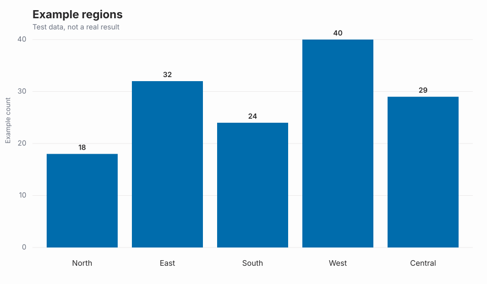
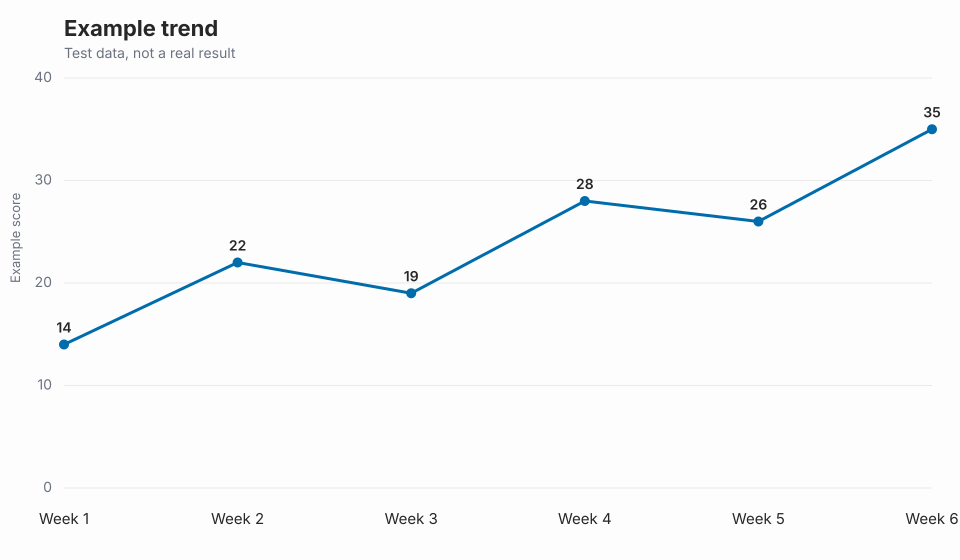

This page is fake test data for the upload format. It is not a real engagement, and none of the figures below are real results.

## Example outcome

> [!QUOTE] This example quote is test data, not something a client said.

A sentence between callouts, so the next metric stays on its own.

> [!METRIC] 12 | Example count labelled as test data

> [!QUOTE] A second example quote, still labelled as test data.
> — Example person

## Example results

> [!METRIC] 48% | Example share labelled as test data

> [!METRIC] 3 | Example weeks labelled as test data

> [!METRIC] C$0 | Example amount labelled as test data

> [!QUOTE] A third example quote after the grouped metrics, still test data.

## Example table

| Example region | Example north | Example east | Example south | Example west | Example central |
| -------------- | ------------- | ------------ | ------------- | ------------ | --------------- |
| Example alpha  | 12            | 18           | 9             | 21           | 14              |
| Example beta   | 7             | 11           | 15            | 8            | 19              |

## Example charts

_Caption: Example bar chart. Test data, not a real result._

_Caption: Example line chart. Test data, not a real result._
